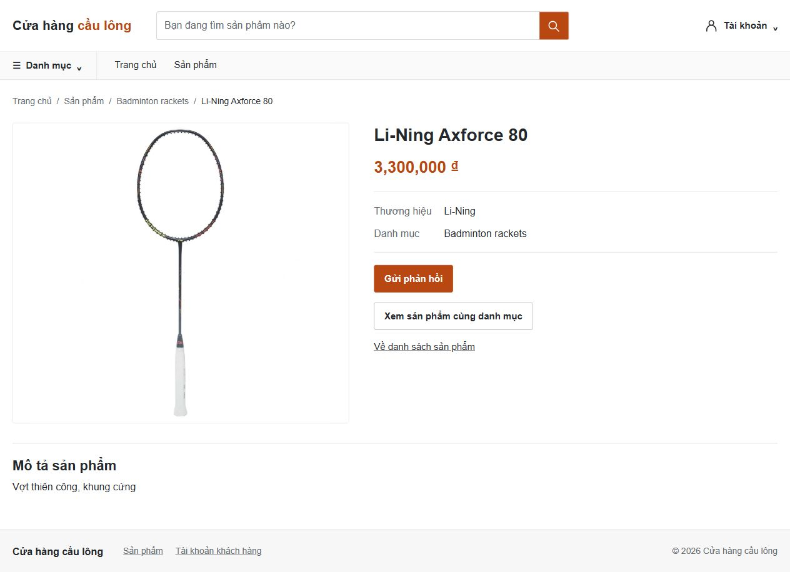

# Đồng bộ catalog và định dạng tiền — 2026-10-29

## Phạm vi và nguyên nhân

Checkout ban đầu sạch, nhánh `develop`. Thay đổi nằm trên nhánh
`codex/catalog-money-consistency`, xuất phát từ cùng revision với `origin/develop`.
Yêu cầu tiếp theo của chủ đồ án cho phép commit và push nhánh này lên GitHub;
không merge vào develop trong bước xuất bản này.
Đã đối chiếu AGENTS.md, plans.md, hướng dẫn chạy dự án, settings/auth/URLs,
models/migrations, forms/services/selectors, seed, JavaScript, templates và tests.
Một số hướng dẫn cũ còn mô tả Customer riêng/supplier; code hiện tại dùng
Customer proxy trên Account. Không sửa kiến trúc này.

Dump và seed catalog dùng `Lining`, trong khi sở thích BRAND dùng `Li-Ning`.
Favorite Brand có danh sách cố định khác catalog. Shop dùng dấu chấm hàng nghìn,
Manager hiển thị Decimal theo locale, các ô giá dùng NumberInput không nhận dấu phẩy.
Phát hiện và sửa thêm hai lỗi trên chính luồng liên quan: đăng ký gửi trường
favorite_brand vào Account thay vì CustomerPreference; lọc audience khảo sát dùng
reverse relation `customerpreference` không còn tồn tại.

## Quy tắc và file

| Nhóm file | Thay đổi |
| --- | --- |
| `apps/catalog/vocabulary.py`, `normalization.py`, `management/commands/normalize_catalog.py` | Alias tường minh `Lining`/`Li-Ning`; lựa chọn thương hiệu ACTIVE tại thời điểm gọi; xem trước và sửa dữ liệu lặp an toàn. |
| `apps/catalog/forms.py`, `selectors.py`, `management/commands/seed_catalog.py` | Giá có parser chung; chuẩn hóa tên nhập; tìm kiếm alias; seed tái dùng ID cũ qua cùng repair thay vì tạo hãng/sản phẩm trùng. |
| `apps/customers/{constants,favorite_brand,models,reports,seed,selectors,self_service_forms,self_services,services,views}.py` | Lựa chọn từ catalog, giữ giá trị đã lưu, chuẩn hóa các đường ghi thông thường/bulk seed, lọc và thống kê alias, sửa đăng ký. |
| `apps/surveys/{forms,services}.py` | Form audience nhận alias cũ; lọc dùng Exists trên FK hiện tại. |
| `apps/catalog/money.py`, `templatetags/money.py`, `apps/shop/{forms,selectors,templatetags/shop_ui}.py` | Parser/formatter Decimal chung, text input, bộ lọc số và tìm kiếm alias. |
| `static/js/money.js`, `templates/{manager/base,layouts/base_customer,catalog/admin/list}.html` | Grouping khi gõ/paste/xóa/sửa giữa chuỗi, giữ con trỏ; hiển thị giá dùng formatter chung. |
| `apps/catalog/test_money_catalog.py` và các tests catalog/shop/favorite_brand/customer_report liên quan | Regression giá, aliases, sửa dữ liệu, catalog choices và bản ghi cũ. Fixture thương hiệu lấy từ catalog; kỳ vọng giá cập nhật theo yêu cầu; fixture Manager và nhãn báo cáo theo portal hiện hành. Test seed dùng customer__email theo FK Account hiện tại. |
| `database/crm_db.sql` | Sửa trực tiếp đúng tên hãng ID 4 và 8 tiền tố tên sản phẩm; không export đè. |

Không đổi schema/FK, migrations, cấu hình quyền, contract JSON hoặc bố cục Admin
của TV3. Rà soát Admin không có trường tiền; không cần sửa template Admin.
Các chức năng tiền hiện có chỉ gồm giá sản phẩm, lọc khoảng giá, danh sách/cards/
chi tiết. Không có báo cáo doanh thu, API tiền hay xuất Excel cần đổi định dạng.

Tên chuẩn là `Li-Ning`. Chỉ đổi token thương hiệu được ánh xạ; tiền tố `Lining `
trong tên sản phẩm liên quan được đổi, phần tên dòng/thuộc tính giữ nguyên.
Repair giữ PK, FK, giá, status và timestamps. Gộp sở thích theo
`(customer_id, preference_type, canonical_value)`, giữ preference_id nhỏ nhất cho BRAND và lớn nhất cho FAVORITE_BRAND
để giữ lựa chọn hiện tại theo quy tắc đọc dòng mới nhất;
không gộp BRAND với FAVORITE_BRAND. Nếu có nhiều brand ID cùng hai alias, lệnh
báo lỗi trước khi ghi để tránh tự quyết định hợp nhất liên kết.

Sáu danh mục hiện có đều là giá trị English hợp lệ: Badminton rackets,
Shuttlecocks, Badminton shoes, Badminton bags, Accessories, Badminton apparel.
Không dịch giá trị lưu hoặc đổi tên/ID. Form CATEGORY đã lấy DB và giữ giá trị
không còn ACTIVE/chưa khớp, chỉ xóa nếu người dùng chọn xóa rõ ràng.
Favorite Brand cũng giữ được tên hãng INACTIVE hoặc không còn trong catalog
khi sửa hồ sơ; dữ liệu mới chọn từ hãng ACTIVE hoặc Other theo flow hiện có.
Sở thích BRAND nhiều giá trị và FAVORITE_BRAND một giá trị vẫn tách biệt.

Kumpoo/VNB xuất phát từ danh sách seed sở thích cũ, không có bản ghi brands
trong dump. Giữ nguyên các dòng cũ, hiển thị/thống kê lại; không tự tạo hãng,
đổi sang hãng khác hoặc xóa dữ liệu. Seed mới chọn từ catalog ACTIVE thực tế.
Việc bổ sung hai hãng vào catalog cần quyết định nghiệp vụ riêng.

Tiền dùng dấu phẩy hàng nghìn, dấu chấm phần lẻ: `1,234` hoặc `1,234.50`.
Không dùng float/tùy tiện xóa ký tự; backend từ chối nhóm sai, chữ, NaN/Infinity,
sai độ chính xác và vượt DECIMAL(12,2). Giữ yêu cầu Product.price > 0, filter >= 0,
trường bắt buộc/tùy chọn và thứ tự min/max. Chỉ input có data-money chịu JS.
Invalid input được giữ nguyên để hiện lỗi; giá SQL vẫn là số `4200000.00`.

## Cập nhật DB đang có

Task này không sửa DB phát triển/demo đang dùng. Runtime hiện đọc DB_NAME
`crm_db_v2`; không sửa `.env` hoặc coi nó là DB chuẩn `crm_db`.
Chọn đúng DB cần triển khai trong cấu hình trước khi chạy lệnh.

```powershell
.\venv\Scripts\python.exe manage.py normalize_catalog
```

Lệnh mặc định chỉ xem trước. Sau khi đã có backup vận hành được xác minh khôi
phục trên DB disposable theo AGENTS.md, chọn thời gian không có ghi đồng thời:

```powershell
.\venv\Scripts\python.exe manage.py normalize_catalog --apply
.\venv\Scripts\python.exe manage.py normalize_catalog
```

Lần xem trước thực tế: brands=1, products=8, preferences=0, merged=0.
Không cần migrate. Không import dump lên DB đang dùng và không dùng seed_catalog
chỉ để repair: seed_catalog vẫn có hành vi seed cũ ghi đè giá/mô tả/status/ảnh demo.
Seed catalog hiện dùng repair chung trước khi seed để không tái tạo alias trùng;
điều kiện backup tương tự áp dụng nếu dùng seed trên dữ liệu hiện có.

## Kiểm chứng thực tế

- Django check: 0 issues; makemigrations --check --dry-run: No changes detected;
  migrate --plan: No planned migration operations. node --check và diff --check đạt.
- Bộ tập trung ban đầu chạy trên test_crm_db gặp schema cũ có supplier_id bắt buộc.
  Không sửa/reset DB này. Tài khoản DB không được tạo tên DB test tùy ý, nên dùng
  DB mới `crm_db_review_export_20261016_8b99` trong quyền sẵn có. Django test runner
  tự tạo/hủy DB này. Không thêm quyền DB.
- Import dump đã sửa vào DB mới, trước đó chưa tồn tại:
  `crm_db_review_import_20261016_8b99`. Không import đè DB đang dùng.
  Đã so sánh toàn bộ rows với dump, tổng rows từng bảng với bản Git trước sửa,
  và giá/PK/brand_id/category_id từng sản phẩm. 22 bảng; accounts 47, brands 5,
  categories 6, products 40, customer_preferences 151, feedbacks 37;
  25 FK kiểm tra, 0 orphan. Cấu trúc/charset/AUTO_INCREMENT không đổi.
  So sánh bytes (chuẩn hóa khác biệt line ending Git/checkout) chỉ có 9 thay đổi
  dự kiến; preference merges trong dump = 0. Không sinh file SQL mới hay backup SQL.
- Trình duyệt thật trên localhost:8002, DB import riêng: Shop nhận typing
  100000000 → 100,000,000; sửa giữa chuỗi giữ caret; phần lẻ 1,234.50;
  xóa sát dấu phẩy không bị kẹt; paste 10,000,000.50; paste 1,00 giữ nguyên và
  backend trả lỗi; Manager sửa giá, lưu 10,000,000.50 và mở lại cùng giá trị;
  danh sách Manager và chi tiết Shop dùng cùng formatter. Dữ liệu QA chỉ nằm
  trong DB disposable. Ảnh: `verification/catalog_money_shop.png`.
- Regression toàn dự án đã hoàn tất: 435 tests / 607.795s, 434 đạt và 1 lỗi
  trong test seed cũ dùng customer__account__email__in trên FK trỏ thẳng Account.
  Đã sửa đúng truy vấn test thành customer__email__in, giữ nguyên kiểm tra dữ liệu.
  Lượt chạy rộng tiếp theo mất phiên thực thi trước khi trả kết quả; không tính là đạt.
  Nhóm tập trung cuối cùng **84/84 đạt trong 48.401s**, bao gồm test seed đã sửa,
  form alias audience, bảo toàn status, gộp favorite mới nhất và toàn bộ tests mới.
  Không khẳng định toàn bộ suite 435 đã được chạy lại thành công sau sửa test.
- Quy tắc giữ favorite mới nhất khi gộp alias đã được kiểm chứng thêm bằng giao
  dịch MySQL riêng trên DB import: lịch sử Lining → Yonex → Li-Ning vẫn đọc
  Li-Ning sau gộp, lệnh lần hai không thay đổi. Giao dịch QA được rollback.
- Đã xóa tài khoản/session QA, khôi phục sản phẩm và timestamp từ dump, dừng
  server; so sánh lại toàn bộ rows/FK đạt. Hai DB riêng chỉ phục vụ kiểm thử,
  không phải nguồn để export đè SQL.

Lệnh runner thực tế dùng `config.test_settings`, rồi đặt
`settings.DATABASES["default"]["TEST"]["NAME"] = "crm_db_review_export_20261016_8b99"`
trước `call_command("test", ...)` để tránh DB test_crm_db cũ. Lượt regression dùng
không labels; lượt cuối chọn Catalog, Shop, FavoriteBrand, OwnProfile,
CustomerReport, SeedDemoData và SurveyBuilder. Logs cục bộ ở `%TEMP%`:
`crm_brandmoney_full.log` và `crm_brandmoney_verified.log`.


