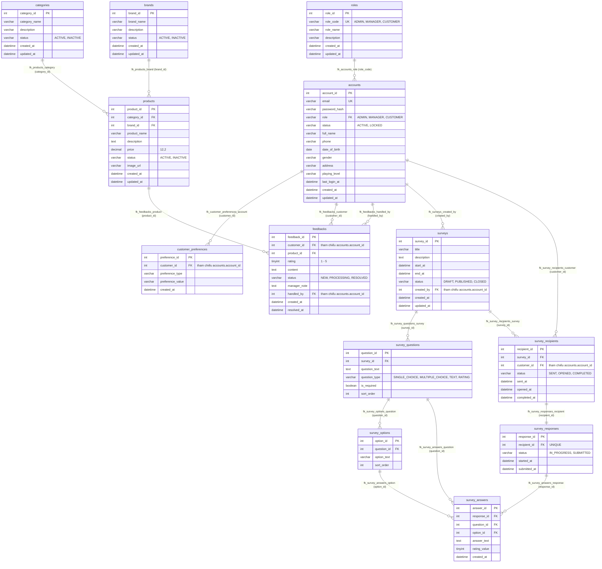

# Tài liệu Đặc tả Cơ sở Dữ liệu CRM (Database Schema Specification)

**Dự án:** Website bán đồ thể thao cầu lông tích hợp hệ thống quản lý quan hệ khách hàng (CRM)  
**Phiên bản cập nhật:** 2026-10-20  
**Hệ quản trị CSDL:** MySQL 8.x (InnoDB)  
**Tên cơ sở dữ liệu:** `crm_db`  
**Bảng mã (Charset / Collation):** `utf8mb4` / `utf8mb4_unicode_ci`  
**Khóa chính & Khóa ngoại:** Signed `INT` (`AutoField` 32-bit)

---

## 1. Tổng quan Kiến trúc Dữ liệu & Các Quyết định Bắt buộc

1. **Loại bỏ triệt để chức năng Nhà cung cấp (Suppliers):**
   - Đã xóa hoàn toàn bảng `suppliers`, cột `supplier_id` trong bảng `products`, cùng toàn bộ khóa ngoại, index (`idx_products_supplier`), dữ liệu mẫu, migration, model `Supplier`, view, form, template, URL và lệnh seed.
   - Bảng sản phẩm (`products`) chỉ thuộc về danh mục (`categories`) và thương hiệu (`brands`). Khi tạo mới database từ đầu hoặc chạy seed, hoàn toàn không tạo lại bất kỳ thực thể nhà cung cấp nào.
2. **Chỉ duy trì 3 Vai trò Nghiệp vụ (RBAC):**
   - Ba vai trò chuẩn: `ADMIN` (Quản trị viên), `MANAGER` (Nhân sự quản lý), `CUSTOMER` (Khách hàng).
   - Được đồng bộ chặt chẽ giữa bảng `roles`, trường `accounts.role`, ràng buộc `chk_roles_code`, `chk_accounts_role`, khóa ngoại `fk_accounts_role`, và hệ thống phân quyền Django Groups / Permissions.
   - Không tồn tại vai trò CSKH hoặc Staff riêng lẻ làm lệch mô hình phân quyền 3 vai trò.
3. **Đặc tả Bảng Tài khoản (`accounts`) & Hồ sơ Khách hàng:**
   - Đã loại bỏ hoàn toàn các trường `position` và `hire_date` khỏi schema SQL, Django models và migrations.
   - Email là định danh bất biến sau khi tạo tài khoản (`uq_accounts_email`).
   - Trạng thái tài khoản (`status`) chỉ có 2 giá trị: `ACTIVE` (đang hoạt động) và `LOCKED` (bị khóa). Không sử dụng trạng thái `DELETED`.
   - Tài khoản ở trạng thái `LOCKED` bị chặn đăng nhập và vô hiệu hóa quyền hạn (`is_active = False`).
   - Bảo vệ an toàn tài khoản Quản trị viên cuối cùng: Hệ thống chủ động ngăn chặn việc tự khóa, xóa hoặc hạ quyền tài khoản Admin cuối cùng (`LastActiveAdminError`).
   - `Customer` được thiết kế dưới dạng **Proxy Model** kế thừa trực tiếp từ `Account`, lưu trữ các thông tin hồ sơ khách hàng (`full_name`, `phone`, `date_of_birth`, `gender`, `address`, `playing_level`) trực tiếp trên bảng `accounts`.
4. **Tính toàn vẹn Dữ liệu & Ràng buộc Xóa (ON DELETE):**
   - Khóa chính (PK) và khóa ngoại (FK) đều sử dụng kiểu signed `INT`.
   - Đã rà soát và loại bỏ các ràng buộc trùng lặp (ví dụ các CHECK constraints tự sinh trùng lặp trên `feedbacks` và `survey_answers`, index trùng lặp trên `survey_responses`).
   - Các quy tắc xóa ràng buộc được thiết lập nhằm bảo toàn lịch sử phản hồi (`feedbacks`), khảo sát (`surveys`, `survey_responses`, `survey_answers`) và hồ sơ khách hàng.

---

## 2. Sơ đồ Quan hệ Thực thể (Entity-Relationship Diagram — ERD)



---

## 3. Danh mục Chi tiết các Bảng Dữ liệu (Data Dictionary)

### 3.1. Bảng `roles` (Vai trò người dùng)
Lưu trữ danh mục vai trò chuẩn của hệ thống CRM.

| Cột | Kiểu dữ liệu | Nullable | Mặc định | Khóa / Ràng buộc | Mô tả |
| --- | --- | --- | --- | --- | --- |
| `role_id` | `INT` | No | AUTO_INCREMENT | PK | Khóa chính vai trò |
| `role_code` | `VARCHAR(20)` | No | — | UNIQUE (`uq_roles_code`), CHECK (`chk_roles_code`: `ADMIN`, `MANAGER`, `CUSTOMER`) | Mã vai trò kỹ thuật |
| `role_name` | `VARCHAR(50)` | No | — | — | Tên hiển thị tiếng Việt |
| `description` | `VARCHAR(255)` | Yes | NULL | — | Mô tả nhiệm vụ vai trò |
| `created_at` | `DATETIME(6)` | No | `CURRENT_TIMESTAMP` | — | Thời điểm tạo |
| `updated_at` | `DATETIME(6)` | No | `CURRENT_TIMESTAMP ON UPDATE` | — | Thời điểm cập nhật cuối |

### 3.2. Bảng `accounts` (Tài khoản người dùng & Khách hàng)
Chứa tài khoản người dùng đăng nhập hệ thống kết hợp thông tin hồ sơ khách hàng.

| Cột | Kiểu dữ liệu | Nullable | Mặc định | Khóa / Ràng buộc | Mô tả |
| --- | --- | --- | --- | --- | --- |
| `account_id` | `INT` | No | AUTO_INCREMENT | PK | Khóa chính tài khoản |
| `email` | `VARCHAR(255)` | No | — | UNIQUE (`uq_accounts_email`) | Email đăng nhập, bất biến |
| `password_hash` | `VARCHAR(255)` | No | — | — | Mật khẩu băm (PBKDF2 SHA256) |
| `role` | `VARCHAR(20)` | No | `'CUSTOMER'` | FK (`fk_accounts_role` → `roles.role_code`), CHECK (`ADMIN`, `MANAGER`, `CUSTOMER`) | Vai trò tài khoản |
| `status` | `VARCHAR(20)` | No | `'ACTIVE'` | CHECK (`chk_accounts_status`: `ACTIVE`, `LOCKED`) | Trạng thái hoạt động |
| `full_name` | `VARCHAR(150)` | No | `''` | — | Họ và tên |
| `phone` | `VARCHAR(20)` | Yes | NULL | — | Số điện thoại liên hệ |
| `date_of_birth` | `DATE` | Yes | NULL | — | Ngày sinh |
| `gender` | `VARCHAR(20)` | Yes | NULL | — | Giới tính (MALE, FEMALE, OTHER) |
| `address` | `VARCHAR(255)` | Yes | NULL | — | Địa chỉ cư trú |
| `playing_level` | `VARCHAR(30)` | Yes | NULL | — | Trình độ chơi cầu lông |
| `last_login_at` | `DATETIME(6)` | Yes | NULL | — | Thời điểm đăng nhập gần nhất |
| `created_at` | `DATETIME(6)` | No | `CURRENT_TIMESTAMP` | — | Thời điểm tạo tài khoản |
| `updated_at` | `DATETIME(6)` | No | `CURRENT_TIMESTAMP ON UPDATE` | — | Thời điểm sửa đổi gần nhất |

*Ghi chú:* Các cột `position` và `hire_date` đã bị loại bỏ hoàn toàn.

### 3.3. Bảng `categories` (Danh mục sản phẩm)

| Cột | Kiểu dữ liệu | Nullable | Mặc định | Khóa / Ràng buộc | Mô tả |
| --- | --- | --- | --- | --- | --- |
| `category_id` | `INT` | No | AUTO_INCREMENT | PK | Khóa chính danh mục |
| `category_name` | `VARCHAR(100)` | No | — | — | Tên danh mục (Vợt, Giày, Quần áo...) |
| `description` | `VARCHAR(255)` | Yes | NULL | — | Mô tả danh mục |
| `status` | `VARCHAR(20)` | No | `'ACTIVE'` | CHECK (`chk_categories_status`: `ACTIVE`, `INACTIVE`) | Trạng thái hiển thị |
| `created_at` | `DATETIME(6)` | No | `CURRENT_TIMESTAMP` | — | Thời điểm tạo |
| `updated_at` | `DATETIME(6)` | No | `CURRENT_TIMESTAMP ON UPDATE` | — | Thời điểm sửa đổi cuối |

### 3.4. Bảng `brands` (Thương hiệu sản phẩm)

| Cột | Kiểu dữ liệu | Nullable | Mặc định | Khóa / Ràng buộc | Mô tả |
| --- | --- | --- | --- | --- | --- |
| `brand_id` | `INT` | No | AUTO_INCREMENT | PK | Khóa chính thương hiệu |
| `brand_name` | `VARCHAR(100)` | No | — | — | Tên thương hiệu (Yonex, Victor, Lining...) |
| `description` | `VARCHAR(255)` | Yes | NULL | — | Mô tả thương hiệu |
| `status` | `VARCHAR(20)` | No | `'ACTIVE'` | CHECK (`chk_brands_status`: `ACTIVE`, `INACTIVE`) | Trạng thái hiển thị |
| `created_at` | `DATETIME(6)` | No | `CURRENT_TIMESTAMP` | — | Thời điểm tạo |
| `updated_at` | `DATETIME(6)` | No | `CURRENT_TIMESTAMP ON UPDATE` | — | Thời điểm sửa đổi cuối |

### 3.5. Bảng `products` (Sản phẩm)

| Cột | Kiểu dữ liệu | Nullable | Mặc định | Khóa / Ràng buộc | Mô tả |
| --- | --- | --- | --- | --- | --- |
| `product_id` | `INT` | No | AUTO_INCREMENT | PK | Khóa chính sản phẩm |
| `category_id` | `INT` | No | — | FK (`fk_products_category` → `categories.category_id`) | Thuộc danh mục |
| `brand_id` | `INT` | No | — | FK (`fk_products_brand` → `brands.brand_id`) | Thuộc thương hiệu |
| `product_name` | `VARCHAR(200)` | No | — | — | Tên sản phẩm |
| `description` | `TEXT` | Yes | NULL | — | Mô tả chi tiết |
| `price` | `DECIMAL(12,2)` | No | — | CHECK (`chk_products_price`: `price >= 0`) | Đơn giá sản phẩm |
| `status` | `VARCHAR(20)` | No | `'ACTIVE'` | CHECK (`chk_products_status`: `ACTIVE`, `INACTIVE`) | Trạng thái bán lẻ |
| `image_url` | `VARCHAR(255)` | Yes | NULL | — | Đường dẫn ảnh minh họa |
| `created_at` | `DATETIME(6)` | No | `CURRENT_TIMESTAMP` | — | Thời điểm tạo |
| `updated_at` | `DATETIME(6)` | No | `CURRENT_TIMESTAMP ON UPDATE` | — | Thời điểm sửa đổi cuối |

*Ghi chú:* Bảng `products` không còn chứa cột `supplier_id` hay bất kỳ tham chiếu nào đến nhà cung cấp.

### 3.6. Bảng `customer_preferences` (Sở thích khách hàng)

| Cột | Kiểu dữ liệu | Nullable | Mặc định | Khóa / Ràng buộc | Mô tả |
| --- | --- | --- | --- | --- | --- |
| `preference_id` | `INT` | No | AUTO_INCREMENT | PK | Khóa chính sở thích |
| `customer_id` | `INT` | No | — | FK (`fk_customer_preferences_account` → `accounts.account_id`, ON DELETE CASCADE) | Tham chiếu tài khoản khách hàng |
| `preference_type` | `VARCHAR(50)` | No | — | — | Loại sở thích (CATEGORY, BRAND...) |
| `preference_value` | `VARCHAR(150)` | No | — | — | Giá trị sở thích |
| `created_at` | `DATETIME(6)` | No | `CURRENT_TIMESTAMP` | — | Thời điểm tạo |

### 3.7. Bảng `feedbacks` (Đánh giá & Phản hồi)

| Cột | Kiểu dữ liệu | Nullable | Mặc định | Khóa / Ràng buộc | Mô tả |
| --- | --- | --- | --- | --- | --- |
| `feedback_id` | `INT` | No | AUTO_INCREMENT | PK | Khóa chính phản hồi |
| `customer_id` | `INT` | No | — | FK (`fk_feedbacks_customer` → `accounts.account_id`) | Khách hàng phản hồi |
| `product_id` | `INT` | No | — | FK (`fk_feedbacks_product` → `products.product_id`) | Sản phẩm được đánh giá |
| `rating` | `TINYINT` | No | — | CHECK (`chk_feedbacks_rating`: `rating BETWEEN 1 AND 5`) | Số sao đánh giá (1-5) |
| `content` | `TEXT` | No | — | — | Nội dung phản hồi |
| `status` | `VARCHAR(20)` | No | `'NEW'` | — | Trạng thái xử lý phản hồi |
| `manager_note` | `TEXT` | Yes | NULL | — | Ghi chú phản hồi của nhân viên |
| `handled_by` | `INT` | Yes | NULL | FK (`fk_feedbacks_handled_by` → `accounts.account_id`) | Nhân viên/Quản lý xử lý |
| `created_at` | `DATETIME(6)` | No | `CURRENT_TIMESTAMP` | — | Thời điểm gửi |
| `resolved_at` | `DATETIME(6)` | Yes | NULL | — | Thời điểm giải quyết |

### 3.8. Bảng `surveys` (Khảo sát)

| Cột | Kiểu dữ liệu | Nullable | Mặc định | Khóa / Ràng buộc | Mô tả |
| --- | --- | --- | --- | --- | --- |
| `survey_id` | `INT` | No | AUTO_INCREMENT | PK | Khóa chính khảo sát |
| `title` | `VARCHAR(200)` | No | — | — | Tiêu đề khảo sát |
| `description` | `TEXT` | Yes | NULL | — | Mô tả mục đích khảo sát |
| `start_at` | `DATETIME(6)` | Yes | NULL | — | Thời điểm bắt đầu |
| `end_at` | `DATETIME(6)` | Yes | NULL | — | Thời điểm kết thúc |
| `status` | `VARCHAR(20)` | No | `'DRAFT'` | — | Trạng thái (DRAFT, PUBLISHED, CLOSED) |
| `created_by` | `INT` | No | — | FK (`fk_surveys_created_by` → `accounts.account_id`) | Người tạo khảo sát |
| `created_at` | `DATETIME(6)` | No | `CURRENT_TIMESTAMP` | — | Thời điểm tạo |
| `updated_at` | `DATETIME(6)` | No | `CURRENT_TIMESTAMP ON UPDATE` | — | Thời điểm sửa đổi cuối |

### 3.9. Bảng `survey_questions` (Câu hỏi khảo sát)

| Cột | Kiểu dữ liệu | Nullable | Mặc định | Khóa / Ràng buộc | Mô tả |
| --- | --- | --- | --- | --- | --- |
| `question_id` | `INT` | No | AUTO_INCREMENT | PK | Khóa chính câu hỏi |
| `survey_id` | `INT` | No | — | FK (`fk_survey_questions_survey` → `surveys.survey_id`, ON DELETE CASCADE) | Thuộc khảo sát |
| `question_text` | `TEXT` | No | — | — | Nội dung câu hỏi |
| `question_type` | `VARCHAR(30)` | No | — | — | Loại câu hỏi (SINGLE_CHOICE, MULTIPLE_CHOICE, TEXT, RATING) |
| `is_required` | `TINYINT(1)` | No | `1` | — | Bắt buộc trả lời (1: Có, 0: Không) |
| `sort_order` | `INT` | No | `1` | CHECK (`chk_survey_questions_sort_order`: `sort_order >= 1`) | Thứ tự sắp xếp câu hỏi |

### 3.10. Bảng `survey_options` (Lựa chọn trả lời câu hỏi)

| Cột | Kiểu dữ liệu | Nullable | Mặc định | Khóa / Ràng buộc | Mô tả |
| --- | --- | --- | --- | --- | --- |
| `option_id` | `INT` | No | AUTO_INCREMENT | PK | Khóa chính lựa chọn |
| `question_id` | `INT` | No | — | FK (`fk_survey_options_question` → `survey_questions.question_id`, ON DELETE CASCADE) | Thuộc câu hỏi |
| `option_text` | `VARCHAR(255)` | No | — | — | Nội dung đáp án lựa chọn |
| `sort_order` | `INT` | No | `1` | CHECK (`chk_survey_options_sort_order`: `sort_order >= 1`) | Thứ tự sắp xếp lựa chọn |

### 3.11. Bảng `survey_recipients` (Người nhận khảo sát)

| Cột | Kiểu dữ liệu | Nullable | Mặc định | Khóa / Ràng buộc | Mô tả |
| --- | --- | --- | --- | --- | --- |
| `recipient_id` | `INT` | No | AUTO_INCREMENT | PK | Khóa chính lượt gửi |
| `survey_id` | `INT` | No | — | FK (`fk_survey_recipients_survey` → `surveys.survey_id`, ON DELETE CASCADE) | Khảo sát được gửi |
| `customer_id` | `INT` | No | — | FK (`fk_survey_recipients_customer` → `accounts.account_id`) | Khách hàng nhận |
| `status` | `VARCHAR(20)` | No | `'SENT'` | — | Trạng thái lượt gửi (SENT, OPENED, COMPLETED) |
| `sent_at` | `DATETIME(6)` | Yes | NULL | — | Thời điểm gửi |
| `opened_at` | `DATETIME(6)` | Yes | NULL | — | Thời điểm mở khảo sát |
| `completed_at` | `DATETIME(6)` | Yes | NULL | — | Thời điểm hoàn thành |

### 3.12. Bảng `survey_responses` (Phiếu phản hồi khảo sát)

| Cột | Kiểu dữ liệu | Nullable | Mặc định | Khóa / Ràng buộc | Mô tả |
| --- | --- | --- | --- | --- | --- |
| `response_id` | `INT` | No | AUTO_INCREMENT | PK | Khóa chính phiếu trả lời |
| `recipient_id` | `INT` | No | — | FK & UNIQUE (`uq_survey_responses_recipient` → `survey_recipients.recipient_id`, ON DELETE CASCADE) | Tham chiếu 1-1 tới lượt gửi |
| `status` | `VARCHAR(20)` | No | `'IN_PROGRESS'` | — | Trạng thái (IN_PROGRESS, SUBMITTED) |
| `started_at` | `DATETIME(6)` | Yes | NULL | — | Thời điểm bắt đầu trả lời |
| `submitted_at` | `DATETIME(6)` | Yes | NULL | — | Thời điểm nộp bài |

### 3.13. Bảng `survey_answers` (Câu trả lời chi tiết)

| Cột | Kiểu dữ liệu | Nullable | Mặc định | Khóa / Ràng buộc | Mô tả |
| --- | --- | --- | --- | --- | --- |
| `answer_id` | `INT` | No | AUTO_INCREMENT | PK | Khóa chính câu trả lời |
| `response_id` | `INT` | No | — | FK (`fk_survey_answers_response` → `survey_responses.response_id`, ON DELETE CASCADE) | Thuộc phiếu trả lời |
| `question_id` | `INT` | No | — | FK (`fk_survey_answers_question` → `survey_questions.question_id`, ON DELETE CASCADE) | Trả lời cho câu hỏi |
| `option_id` | `INT` | Yes | NULL | FK (`fk_survey_answers_option` → `survey_options.option_id`, ON DELETE CASCADE) | Lựa chọn đã chọn (nếu có) |
| `answer_text` | `TEXT` | Yes | NULL | — | Nội dung trả lời tự luận |
| `rating_value` | `TINYINT` | Yes | NULL | CHECK (`chk_survey_answers_rating`: `rating_value BETWEEN 1 AND 5`) | Điểm đánh giá (1-5 nếu có) |
| `created_at` | `DATETIME(6)` | No | `CURRENT_TIMESTAMP` | — | Thời điểm ghi nhận |

---

## 4. Các Bảng Kỹ thuật của Django (Technical Tables)

Hệ thống duy trì 8 bảng kỹ thuật phục vụ quản lý phiên, phân quyền Django Group/Permission và migration:
- `django_migrations`: Theo dõi lịch sử thực thi migration.
- `django_session`: Quản lý phiên làm việc đăng nhập của người dùng.
- `django_content_type`: Đăng ký các ContentType của models.
- `django_admin_log`: Nhật ký thao tác trong giao diện Django Admin.
- `auth_permission`: Danh mục quyền chi tiết của Django.
- `auth_group`: Các nhóm quyền của Django (`CRM_MANAGER`, `CUSTOMER_SERVICE`).
- `auth_group_permissions`: Bảng liên kết M2M giữa Nhóm và Quyền.
- `accounts_groups`: Bảng liên kết M2M giữa Tài khoản (`accounts`) và Nhóm (`auth_group`).
- `accounts_user_permissions`: Bảng liên kết M2M giữa Tài khoản (`accounts`) và Quyền riêng lẻ (`auth_permission`).

---

## 5. Chính sách Toàn vẹn Dữ liệu & Quy tắc Khóa Ngoại (Foreign Keys)

Hệ thống thiết lập 25 quan hệ khóa ngoại (16 cho nghiệp vụ và 9 cho hạ tầng Django auth/admin):

1. **Bảo toàn lịch sử Phản hồi & Khảo sát:**
   - Khi xóa sản phẩm (`products`), hệ thống ngăn chặn nếu đã có `feedbacks` tham chiếu tới.
   - Tài khoản có tham chiếu đến `feedbacks` (`customer_id` hoặc `handled_by`), `surveys` (`created_by`), hoặc `survey_responses` đã hoàn thành đều được bảo vệ trong service layer (`_has_protected_references` trong `apps.accounts.services`). Không thể xóa thô gây mồ côi hoặc mất dữ liệu lịch sử.
2. **Quy tắc phân tầng Khảo sát:**
   - Xóa `survey` sẽ tự động xóa các câu hỏi (`survey_questions`) và người nhận (`survey_recipients`) theo chuỗi liên hoàn có kiểm soát.
   - Xóa `question` tự động xóa các lựa chọn (`survey_options`) và câu trả lời liên quan (`survey_answers`).
3. **Phân quyền và bảo vệ Quản trị viên:**
   - Quy tắc bảo vệ Admin cuối cùng: Nếu hệ thống chỉ còn 1 tài khoản `ADMIN` ở trạng thái `ACTIVE`, mọi thao tác khóa, xóa, hoặc hạ vai trò của tài khoản này đều bị từ chối với ngoại lệ `LastActiveAdminError`.

---

## 6. Hướng dẫn Tái tạo và Khởi tạo Cơ sở Dữ liệu

### 6.1. Khởi tạo từ file DDL chuẩn (`database/crm_db.sql`)
1. Tạo CSDL rỗng với đúng bảng mã:
   ```sql
   CREATE DATABASE crm_db CHARACTER SET utf8mb4 COLLATE utf8mb4_unicode_ci;
   ```
2. Thực thi nạp script SQL:
   ```powershell
   mysql -h 127.0.0.1 -P 3306 -u root -p crm_db < database/crm_db.sql
   ```

### 6.2. Nạp dữ liệu mẫu (Seed Data)
Hệ thống cung cấp các lệnh quản trị Django đã được làm sạch hoàn toàn:
```powershell
# Nạp dữ liệu tài khoản, phân quyền, sản phẩm, phản hồi và khảo sát demo
python manage.py seed_data

# Nạp bổ sung danh mục sản phẩm 40 mặt hàng cầu lông (5 thương hiệu, 6 danh mục, 0 nhà cung cấp)
python manage.py seed_catalog

# Nạp dữ liệu mẫu khảo sát chi tiết
python manage.py seed_surveys
```

### 6.3. Sao lưu & Phục hồi CSDL
- **Sao lưu:**
  ```powershell
  python manage.py backup_database --purpose="scheduled_backup"
  ```
- **Kiểm thử phục hồi:** Dịch vụ phục hồi `apps.admin_portal.services.restore_service` hỗ trợ kiểm tra tính toàn vẹn và phục hồi an toàn vào cơ sở dữ liệu mục tiêu đã chỉ định.
