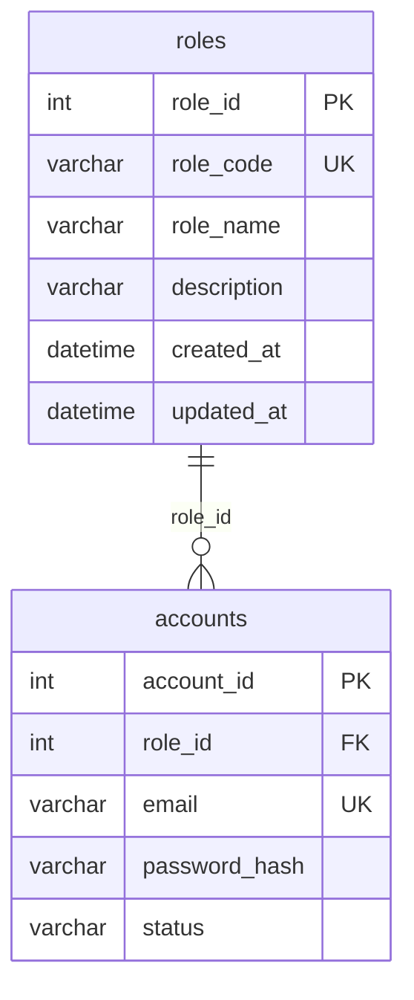

# Safe Account Role Normalization

Baseline: `develop`, `28eb667fb7e7a56011eff2eb85729d85ad5e2702`, fetched from origin on 2026-11-06. Initial working tree clean. Feature branch: `feature/normalize-account-role`.

## Scope and compatibility

See [IMPACT_MATRIX.md](IMPACT_MATRIX.md) for every affected source file, risk and verification. Accounts/auth/session/RBAC, Customer proxy and Survey targeting are high risk. Feedback guards, seed/export/audit scripts and four templates change only their role access. Catalog, Shop, prices, feedback status, survey lifecycle, URL routing, Groups and CSRF policy retain existing behavior.

`Account.role` is now an actual `Role` relation and `Account.role_id` its integer attname. The former string property named role_id is removed. Business logic reads `Account.role_code`; ORM lookups use `role__role_code`, including projections and related-customer lookups. No filter-rewriting property or fake relation hides the schema. Python consumers outside this repository must adapt their old string reads/filters. String account construction/create_user and QuerySet.update input are explicitly resolved by code; numeric IDs are never fixed in business code.

API/form request and response fields remain `role`, with ADMIN/MANAGER/CUSTOMER strings. The selectors explicitly serialize the code, including profile.type. Existing endpoint, status, error, birthday, immutable-email, special-admin, final-admin, account-code and group rules remain under the original regression assertions. Tests referencing Python model role strings now assert role_code; the physical-column assertion now expects role_id. No business assertion was removed or weakened.

## Migration and preservation

* 0005: add nullable role_id through temporary state field role_link; validate role codes; resolve/create only the three roles by code; backfill; verify exact mapping; enforce NOT NULL and FK.
* 0006: remove old CHECK and VARCHAR column; rename the state field to role without moving the physical role_id column. Reverse migration restores old strings before reinstating their CHECK.
* 0007: remove the duplicate field-level role-code unique index, retaining uq_roles_code and chk_roles_code.

The restored MySQL schema has `updated_at ON UPDATE CURRENT_TIMESTAMP`. Initial rehearsal detected timestamp changes; backfill and reverse mapping now explicitly assign updated_at to its previous value. Verification against a newly restored clone proved all 20 original Account rows identical when projected through the new role relationship, including IDs, email, hashes, status, profile and timestamps. Role display names intentionally become Quản trị viên / Quản lý / Khách hàng; Role IDs, codes, descriptions and timestamps are preserved.

Verified recovery backup: `database/backups/crm_261106_161602.sql` and its SHA256 manifest, retained locally and excluded from this change's commits. Existing canonical backup retained. All 22 tables restored identically before rehearsal. Corrected rehearsal: `crm_db_role_clone_v2_20261106`; 20/20 mappings (2 ADMIN, 3 MANAGER, 15 CUSTOMER); all 25 physical FKs checked; zero orphans. Fresh MySQL migration, clone forward/reverse/forward and single unique-code index verified. Historical migration files are unchanged.

## Test evidence

Baseline full suite: **504 passed, 0 failed, 0 errors, 0 skipped**, 424.34 seconds, independent `test_crm_audit_53daf1ba98`; source fingerprints unchanged. Structured per-test evidence is in baseline/.

The first completed refactor run recorded 508 passed and one CSS-test failure caused by an unintended literal replacement in the test, corrected by restoring the original assertion. The final complete rerun is recorded in verified/. Intermediate failures remain distinguished from the clean baseline.

Five additional tests cover actual FK object/integer IDs, stable API codes, arbitrary Role IDs, ORM/SQL protected deletion, null/orphan/invalid role rejection, absence of the old column and exactly one unique role-code index. Existing tests continue to cover role revocation, Groups privilege boundaries, locked sessions and all six cross-portal login/logout orders with actual CSRF-enforcing POSTs.

Real HTTP audit: **14/15 passed**. The remaining legacy CLI seed-cleanup case attempts legacy fixture seeding into the final demo and is correctly rejected by a pre-existing protection guard. Running the exact command source from baseline reproduced the identical CommandError without writes; see http/baseline_seed_guard.json. The production guard is retained and this failure is not hidden. The full automated suite separately tests legacy seed cleanup on suitable fixtures.

Real Admin restore E2E passed full restore, malformed SQL rejection, automatic exact recovery after partial import, fail-closed damaged recovery and operator recovery, and required operation logs. All source fingerprints unchanged. Full synthetic SQL was exported from a freshly migrated/seeded disposable database; repeat seed and two data-only imports leave every table fingerprint unchanged. No real credentials or live backup are committed. JavaScript syntax checks pass; JavaScript source was not changed.

## Deployment and recovery

Deployment evidence is recorded in deployment.json only after all gates pass. The deployment script checks the exact local host/database, completed regression and explained baseline HTTP failure, unchanged source fingerprint, absence of other database clients or enabled database events, and an exclusive HTTP maintenance lock. It takes another full backup and verifies its restore before applying migrations. It does not import DROP TABLE dumps into the live database.

For a completed migration requiring rollback: keep HTTP stopped, inspect schema/history, run the rehearsed reverse migrations to accounts.0004, then restore the baseline code before reopening traffic. Role display labels remain normalized. MySQL DDL is not assumed transactional. For partial DDL failure, keep the recovery marker and HTTP maintenance active; inspect the exact completed DDL/history before repair. Restore the verified full backup into a new disposable recovery database to establish a validated source for recovery; do not overwrite live tables with a dump or reset the database. Backups and their manifests stay in database/backups/.

## ERD

## Limits

The local owner demo is the only deployment target authorized here. Shared/production rollout requires its own coordinated window. HTTP locks do not coordinate external SQL clients; the script rejects visible concurrent clients and events. Browser pixel/console automation was not repeated; template/HTTP/session tests and syntax checks provide functional coverage. The old HTTP audit's CLI fixture assumption remains an explained baseline limitation. Temporary owned clone databases and verified recovery media are retained for review.

## Final verified outcome

Full final suite: **509 PASS, 0 FAIL, 0 ERROR, 0 SKIP**, 445.41 seconds, isolated test_crm_audit_05ec4cfdf0. Per-module counts: [TEST_RESULTS.md](TEST_RESULTS.md). Baseline and final JSON retain every test ID and result.

**DEPLOYED_VERIFIED** on local crm_db. New immediately pre-deployment backup crm_261106_163800.sql was restored and compared identically before migration. Accounts 0005/0006/0007 actually applied. Mapping 20/20, 25 FKs, zero orphans; all account/unrelated data preserved, only role display labels intentionally normalized. Post-deployment: all 20 credential checks, seven protected page renders and five real HTTP GETs pass with all table fingerprints unchanged. Django check and makemigrations --check pass; no pending migrations. Server restarted at http://127.0.0.1:8000/. See deployment.json and live_smoke.json.
